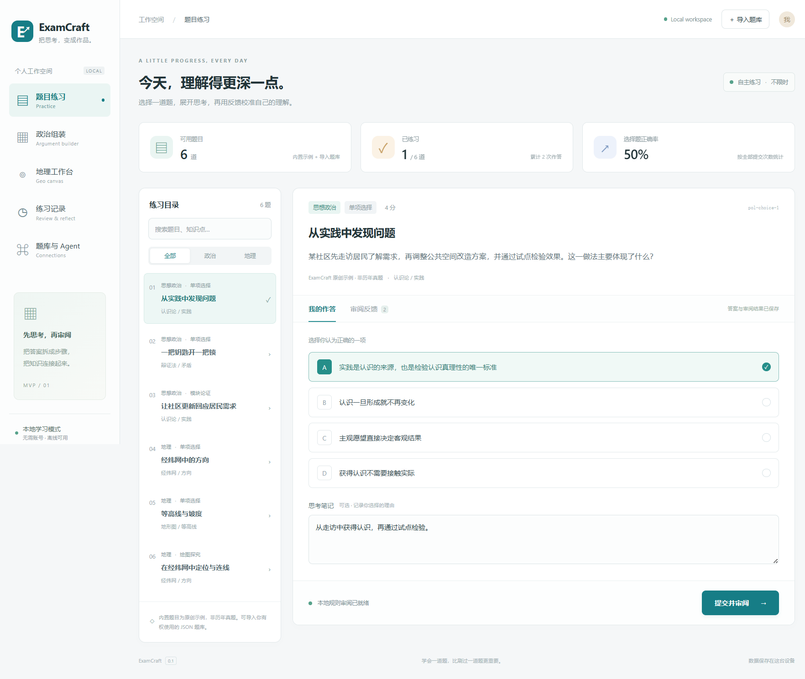

# ExamCraft

一款 **Electron + React + TypeScript** 学科 IDE。覆盖语文、数学、英语、政治、历史、地理六科，把选择题、文字解答、文科嵌套论证模块、数学交互工具和地理坐标图放进同一个本地学习空间。

首个 MVP 的完整闭环：**选题 → 作答 / 自动保存草稿 → 提交 → 规则反馈与解析 → 查看历史 → 重做**。无需账号或 API Key，安装完成后可离线练习。仓库原有 GPL-3.0 许可证保留。



## Windows 便携版

在 [GitHub Releases](https://github.com/Zis30axs/vibe-studying/releases) 下载对应版本的 `ExamCraft-<版本>-win-x64.zip`，完整解压后打开 `ExamCraft.exe`。便携包包括 Electron 运行时，无需安装 Node.js；不要只移动 EXE，须保留旁边所有文件。

这是未签名的 Windows x64 便携应用。Windows 可能提示未知发布者；只运行你确认可信的下载，并可用同版 `SHA256SUMS.txt` 校验文件。默认学习数据仍在 `%APPDATA%\ExamCraft`，升级前先退出应用并备份。应用内部版本为 0.2.0；此手工便携包保留 Electron 的默认 EXE 图标与 Windows 文件属性，不代表应用内版本。没有自动更新器。

开发者可在 Windows x64 干净提交检出中运行：

```sh
npm ci
npm run check
npm run test:e2e
npm run package:win
npm run test:packaged
```

产物位于 `work/release/`：可运行 Windows ZIP、对应源码 ZIP、SHA-256 校验文件。GitHub 发布流程只在 Linux/Windows 检查、全部桌面用例及解压后可执行文件烟雾测试通过后发布，且不覆盖已有版本。详见 [0.2.0 发布说明](docs/releases/v0.2.0.md)。

## 本地运行

需要 Node.js **22.13+（推荐 24 LTS）**、npm，以及支持 Electron 的桌面系统。首次安装/启动需要联网下载 npm 依赖与 Electron 二进制。

```sh
git clone https://github.com/Zis30axs/vibe-studying.git
cd vibe-studying
git switch main
npm ci
npm run dev
```

开发模式同时启动 Vite 和 Electron；React 页面支持热更新，修改 `electron/` 或 `mcp/` 后需重启。`npm run dev:web` 仅供调试页面服务，完整功能需要 Electron 的本地 API。

构建并启动生产页面：

```sh
npm run build
npm start
```

`build` 生成 `dist/`、`dist-electron/`、`dist-mcp/`，本身不是安装包；Windows 可用上方 `package:win` 组装便携版。`start` 需要先构建。若首次 Electron 下载失败，可在网络恢复后运行 `npx --no install-electron`。

## 试用顺序

1. **题目练习**：选择“从实践中发现问题”，选一个选项、写下理由、提交。选择题按标准答案判分；解析只在提交后的界面展示。
2. **练习记录**：查看本次答案、时间、得分和解析；重新练习会新增记录，保留先前提交。
3. **文科组装**：展开正文下方的文科模块工作台，添加空白模块，在自由画布上任意拖动。通过明确的逻辑连接安排父子关系与顺序；位置不会改变正文顺序。填写内容后，点“用模块更新正文”，检查并自由修改正文，再提交自查。
4. **地理工作台**：切换经纬度，添加 A(20,30)、B(40,50)，连线并解释方向。支持精确坐标输入、鼠标描点、编辑、删除、撤销；换坐标系需要确认清空。
5. **数学工作台**：在数学题旁绘制函数、调节 a/b/c 参数、拖动几何点并测量距离与角度；写下推理后提交。
6. 关闭再打开应用，草稿和提交历史仍保留。右上角可导入 `examples/question-bank.json`，然后搜索“导入示例”。

内置 18 道题均为**原创演示题，非历年真题**。主观题的“分数”只是关键词规则自查结果，不判断否定、语义、论证顺序或图形是否正确，不能当作考试评分。绘图和模块编辑均保存在提交快照中。

## 六科练习

在「题目练习」按学科筛选；每科有 3 道原创演示题，共 18 道。

- 语文：修辞选择、现代文阅读、建议表达。
- 数学：函数选择、方程步骤、概率解释；文字作答旁提供函数曲线、参数滑块、可拖动几何点和距离/角度测量。
- 英语：阅读选择、证据分析、邀请邮件；显示参考词数。
- 政治：选择题与嵌套模块论证。
- 历史：史料选择、材料分析、因果解释；模拟史料明确标记为原创情境。
- 地理：原有选择题与坐标绘图。

新科目同样支持自动保存、逐项自查、历史快照和重做。原 version-1 题库与学习记录无需迁移，原题 ID 不变。升级时，已导入题目优先保留；若新示例与旧导入 ID 冲突或总量会超过 1000 道，则不加载相应的新示例，不覆盖旧题与历史。六科可通过相同 JSON 格式导入、按 MCP 学科范围查询和审阅；新增示例见 `src/domain/extra-sample-questions.ts`。

本地文字审阅只是关键词覆盖提示：不验证数学公式、英语语法、语文立意或历史因果。英语按词语边界匹配，仍可能漏掉同义表达或误判否定句。自定义模型请求包含各学科的评阅关注点，但仍须逐次同意发送，模拟测试不能证明真实模型的评分质量。

## 学习提交热力图

页面上方显示最近 26 周的本地日历：一天一格，颜色随当天已保存的提交次数逐级加深（0、1、2–3、4–6、7 次及以上）。点击或用键盘聚焦日期，可以查看当天记录并打开对应的审阅历史。

热力图直接从已有提交历史计算：重做后再次提交会累计；自动保存草稿、校验失败和没有生成已保存记录的 API 失败不会增加次数。当天日期按运行应用的电脑本地时区计算，跨午夜会自动更新；无效时间戳、未来提交时间和显示范围之外的记录不计入当前图。切换电脑时区后，历史记录所属日期会按该时区重新显示。无提交的日期保持中性色，不评价连续学习天数。

## 文科模块工作台

- **自由画布**：观点、材料、分析、结论与因果、对比、分点容器均有独立位置。拖动模块仅调整布局，显式逻辑连接才改变嵌套或顺序；画布支持平移、缩放、适应内容、撤销与键盘移动。
- **紧凑工作区**：正文优先显示；普通练习中的大型工具默认折叠，专用工作台导航自动展开。展开后可拖动右下角调整高度或切换扩大视图。统计和热力图收进“学习概览”，原记录不变。
- **兼容旧结构**：旧的嵌套与扁平模块自动取得初始布局，逻辑顺序、文字、最终正文与提交快照保持不变。布局写入可选 canvas 字段。
- **最终正文由你控制**：模块生成预览不会自动覆盖正文。“用模块更新正文”才会同步；正文已有不同内容时需确认覆盖，可取消。修改模块后仍可保留手写正文；提交与关键词自查以当前最终正文为准，新模块草稿需要先填写或同步正文（地理仍可仅提交绘图）。
- **本地保存与历史**：每次改动自动保存；历史保留提交时的嵌套结构和最终正文。已有 version-1 草稿、扁平模块、题库导入和历史继续可读。旧模块在工作台中映射为叶节点；新结构写入可选 argument 字段，旧字段保留。新版本写出的 argument 字段不保证被旧版程序读取，请先备份数据。
- **有界结构**：最多 80 个模块、6 层，每块最多 4,000 字，生成正文最多 20,000 字；拒绝循环、共享节点、重复 ID 和超限结构。超限的旧内容不会被自动截断，需先保留备份并缩减内容后转换。
- **审阅边界**：本地自查不理解嵌套逻辑、不验证因果或论点正确性。自定义模型仅在逐次确认后接收当前题目、当前正文、嵌套结构、绘图及本次学习范围；修改任何答案内容后须重新确认。此功能未使用真实 API 凭据验证评分质量。

## AI 地理示意题生成

在“地理工作台”展开“AI 生成地理题”，选择课程/考纲、章节与难度。检查本次输入、模型与接收方并确认后，生成一道原创主观题；仅发送这些范围信息和固定出题要求，不发送学习记录、当前答案或账号资料。使用现有四种模型协议。

先预览题面和示意图，解析与评分依据只在主进程内保留；点击“加入题库并开始练习”才持久化。可舍弃后重新确认生成，不自动重试。每次应用运行最多派发5次出题请求（失败/取消也可能计数），最多保留3个待选预览，且一次只生成一题。预览重启后丢失；已加入题库的题目、草稿及提交快照会保存。题干重复时拒绝加入，不覆盖旧题。

示意图只接受有界的点、线段、箭头、折线、多边形、标签与网格；坐标 -100～100，最多80个元素，ID唯一且连线必须引用已有点。不接受 SVG/HTML/JavaScript、URL、远程图片或模型指定的执行动作。图形由固定 React/SVG 组件绘制，归一化坐标只表示示意位置，不是实测地图。

AI 生成标记和来源会保留在题库、导入及提交时的题面快照中。结构校验不验证地理事实、题意是否科学、图形比例或参考答案质量；不是历年真题，也不是官方评分。出题指令要求简单、条件充分的相对位置/流向/区域示意，禁止伪造精确实测地图、等值线、天气及人口数据；模型仍可能不遵守，使用前后都应核对。参考 rubric 只能保证非空和分值一致，不应理解为经过专家审核。

## 数学交互工具

数学题旁的工作台提供：

- **函数曲线**：输入单个 `y = f(x)` 的右侧表达式，例如 `a*x^2+b*x+c` 或 `a*sin(b*x)+c`；a/b/c 的滑块实时更新曲线。
- **几何交互**：在直角坐标系描点、精确编辑坐标、拖动点和连接两点。坐标范围为 x、y 各 `[-10, 10]`。
- **测量**：依次选择两个点计算欧氏距离，选择三个点计算以第二点为顶点的角度（度数）；重合的边端点无法定义角度。
- **保存与回看**：函数、参数、点线和测量选点随当前题目自动保存，也写入每次提交的独立快照。原有 version-1 无数学字段的草稿与历史仍可读取。

表达式使用有界的专用解析器，不执行 JavaScript，也不使用 `eval` / `Function`：

- 变量 `x`，参数 `a`、`b`、`c`（各为 `[-10, 10]` 有限数），常量 `pi`、`e`。
- 运算 `+ - * / ^`、括号、正负号；支持小数与科学计数法。幂从右向左结合，`-2^2` 为 `-4`。
- 函数 `sin`、`cos`、`tan`（弧度）、`sqrt`、`abs`、`exp`、`log`（自然对数）。函数必须加括号，乘法必须显式写 `*`；不接受 `2x`、`Math.sin(x)`、赋值、属性访问或脚本。
- 最多 160 字符、120 个词法符号、32 层嵌套。可清空表达式以只使用几何工具。

曲线是固定视窗 `[-10, 10] × [-10, 10]` 内的数值采样预览；遇到无定义、非有限值、越界或疑似不连续区间时断开。它不是符号计算系统，不能保证发现全部间断点、极值或快速振荡，也不自动解方程或证明几何命题。测量是基于当前浮点坐标的近似数值。本地评分仍只检查文字关键词，主观数学题必须填写推理文字；图形本身不作为正确性的判定。工具不新增题目，也不会自行调用云端。

数学函数输入可留空或点击「清除函数」，只保留几何图形。参数数值输入超出范围或不完整时不会保存，离开输入框会恢复最后有效值。

## 数据与题库

数据保存在 Electron 的 `app.getPath('userData')` 下：

- Windows：通常为 `%APPDATA%/ExamCraft/`
- macOS：通常为 `~/Library/Application Support/ExamCraft/`
- Linux：通常为 `~/.config/ExamCraft/`
- `study-state.json`：草稿与全部提交快照。
- `question-bank.json`：导入的题目；不包含内置题。

写入经队列串行化，先写临时文件并同步，再原子替换；关窗等待在途草稿/提交落盘。损坏或不兼容文件会报错并保留原文件，不会静默重置。备份时先退出应用，再复制整个数据目录；当前没有自动备份或数据迁移工具。每个 JSON 文件上限 8 MiB，总题目数上限 1000（包括内置 18 道）；达到限制时拒绝新写入并保留原数据。

导入是**追加**：重复 ID 会拒绝整批导入，不覆盖题目或历史。只读取用户通过本地文件选择器选中的 JSON 文件。格式如下；完整可导入文件见 [examples/question-bank.json](examples/question-bank.json)，字段校验见 [schemas.ts](src/domain/schemas.ts)。

```json
{
  "version": 1,
  "questions": [
    {
      "id": "my-geo-1",
      "subject": "geography",
      "kind": "choice",
      "title": "纬度的起点",
      "prompt": "纬度 0° 对应哪条线？",
      "source": "个人原创示例",
      "tags": ["经纬网"],
      "maxScore": 4,
      "choices": [
        { "id": "A", "text": "赤道" },
        { "id": "B", "text": "本初子午线" }
      ],
      "correctAnswer": "A",
      "explanation": "赤道是纬度 0° 的纬线。"
    }
  ]
}
```

`subject` 为 `chinese` / `math` / `english` / `politics` / `history` / `geography`；`kind` 为 `choice` 或与学科相同的值。所有学科支持选择题；语文、政治、历史、地理主观题可使用嵌套模块辅助作答；数学、英语使用文字作答，数学可附带交互工具状态，地理同时保留绘图。主观题必须提供 `rubric`（`id`、`label`、`keywords`、`points`），分值之和等于 `maxScore`；政治题可提供 `blocks`（`id`、`category`、`label`、`text`）。模板见 [sample-bank.ts](src/domain/sample-bank.ts)。仅导入你有权使用的题目，来源字段用于追溯。

## 本地 MCP 与 Agent 扩展

这是实际使用官方 SDK 的 **stdio MCP 服务**，与桌面应用共享题库校验和规则审阅。桌面 MVP 直接调用本地适配层；外部 MCP 客户端可以独立启动服务。

```sh
npm run build
node dist-mcp/server.cjs --subject geography --tag 经纬网
```

该命令会等待 MCP 客户端输入，并非交互式命令行。配置客户端时直接启动 `node`，避免 npm 日志混入协议 stdout：

```json
{
  "mcpServers": {
    "examcraft": {
      "command": "node",
      "args": [
        "C:/absolute/path/vibe-studying/dist-mcp/server.cjs",
        "--subject",
        "geography",
        "--tag",
        "经纬网"
      ]
    }
  }
}
```

将路径改为自己的绝对路径。可用选项：

| 参数                              | 作用                                                 |
| --------------------------------- | ---------------------------------------------------- |
| `--subject chinese` 等六科学科 ID | 限定学科                                             |
| `--tag 经纬网`                    | 限定标签；可重复，多个标签取交集                     |
| `--question-id geo-choice-1`      | 限定题号；可重复，多个 ID 取并集，再与其他条件取交集 |
| `--bank /absolute/path/bank.json` | 使用指定题库快照，替代内置题库；路径必须绝对         |

默认 `--reference-access student`：list/get 不返回答案、解析、rubric 或参考模块。显式指定 `--reference-access full` 才允许受信任教学 Agent 读取完整题目；工具参数不能提升此权限。`review_answer` 是独立的提交后阅卷能力，会返回解析；不要把它或 full 模式接入未获准揭示参考内容的解题上下文。详细边界见 [MCP 角色说明](docs/mcp-roles.md)。

服务器范围在启动时固定，工具请求只能进一步缩小范围。`list_questions`、`get_question`、`review_answer` 都执行范围检查。未指定 `--bank` 时仅服务内置示例；指定桌面的 `question-bank.json` 时仅服务已导入的题目。MCP 进程只读题库，审阅不会写桌面历史；调整题库后需重启 MCP 服务。

| 工具             | 输入                                  | 输出                                         |
| ---------------- | ------------------------------------- | -------------------------------------------- |
| `list_questions` | 可选 `subject`、`tags`、`questionIds` | 默认返回允许范围内的作答题目（不含参考内容） |
| `get_question`   | `questionId`                          | 默认返回单题作答视图；full 模式才含参考内容  |
| `review_answer`  | `questionId`、`draft`                 | 规则反馈，不保存历史                         |

最小 `draft`：

```json
{
  "choiceId": "C",
  "text": "",
  "blocks": [],
  "drawing": { "mode": "cartesian", "points": [], "lines": [] }
}
```

数学作答可以在 `draft` 中附带可选 `math` 字段；旧客户端不传该字段仍有效。示例：

```json
{
  "expression": "a*x^2+b*x+c",
  "parameters": { "a": 1, "b": 0, "c": 0 },
  "drawing": {
    "mode": "cartesian",
    "points": [
      { "id": "A", "x": 0, "y": 0, "label": "A" },
      { "id": "B", "x": 3, "y": 4, "label": "B" }
    ],
    "lines": [{ "id": "AB", "from": "A", "to": "B" }]
  },
  "measurement": ["A", "B"]
}
```

`measurement` 按选择顺序保存最多 3 个不同的现有点 ID；数学图形只允许直角坐标系。MCP 的 `review_answer` 会校验该状态，但仍只返回本地规则审阅，不操作桌面工作台、生成图形或发送云端模型请求。

适配器接口位于 [contracts.ts](src/adapters/contracts.ts)：

- `QuestionBankAdapter`：`list(scope)` / `get(id, scope)`。
- `AgentAdapter`：`review(question, draft)`。
- `LocalQuestionBank` / `LocalRuleAgent`：当前默认实现。
- `McpQuestionBankAdapter` / `McpAgentAdapter`：接受宿主已连接的可信 MCP `Client`，校验工具返回值。不会接受题库中提供的命令或自动启动未知程序。

桌面审阅与选文提示使用主进程中的模型适配器；MCP 仍为本地规则。地理示意题可由用户逐次发起生成；没有后台持续出题或自动提交答案。

## 自定义模型与 Ask Advisor（可选）

默认仍为离线本地规则。在“题库与 Agent → 模型设置”中选择协议、HTTPS 基础地址和模型名，填写本次会话 API Key。支持 Anthropic Messages、Gemini generateContent、OpenAI Responses 和 OpenAI Chat Completions 兼容接口。

- Anthropic 基础地址示例：`https://api.anthropic.com/v1`，追加 `/messages`。
- Gemini 示例：`https://generativelanguage.googleapis.com/v1beta`，追加 `/models/{model}:generateContent`。
- OpenAI 示例：`https://api.openai.com/v1`，追加 `/responses` 或 `/chat/completions`。
- DeepSeek 可继续使用 Chat Completions 协议与 `https://api.deepseek.com`。已有 DeepSeek 启动配置保留兼容迁移。

请填写基础地址而非完整调用路径。仅支持公开 HTTPS 服务，拒绝内网地址、带认证信息或查询参数的 URL；不自动跟随重定向，连接时检查 DNS 地址。模型需支持相应协议及 JSON 输出；工具调用、拒绝、截断、不支持的输出与结构错误会明确失败，不将其写成成绩。协议支持不保证任意模型、代理服务或推理模式都兼容。

非秘密设置保存在本机；API Key 仅在当前进程会话使用，重启后重新输入。输入框保存时立即清空，不写学习记录、文件、浏览器存储或日志。修改协议或地址会清除旧密钥。不要把密钥放进聊天、答案或考纲中。

### 选文提示

在题干、材料模块或正文中选择文字，点击浮动的 **Ask Advisor**；键盘选择后也可用工具栏按钮。请求前核对选中摘录、协议、模型和接收方，逐次确认发送。默认发送选中文本、来源类别及按本题题号从主进程取得的必要题目信息；不会附上其余答案、历史或账号资料。“允许顾问参考本题解析和评分依据”默认关闭，只有本次明确勾选后才从主进程补充参考内容，且最终发送还需再次确认。参考原文不会通过题目列表送入作答区。返回的是学习提示，始终显示在独立面板，不替换正文；支持取消、关闭、错误重试，换题或更换配置后旧请求失效。

### 克制的模块检查与版本时间树

展开文科工作台中的“检查模块”，选择几个模块（容器包含其子模块）或全部模块；单个模块还可在原文快照中选择片段，限定建议的修改范围。发送前核对题干、模块文字及逻辑层级、模型与接收方并逐次同意。参考解析和 rubric 由主进程按题号取得，仅在单独勾选参考授权时发送给顾问；不在作答区或本地发送内容预览中展示原文。选区模式仍会发送已显示的模块全文以保持上下文；不发送最终正文、画布位置、版本历史、账号资料或其他练习。

固定提示词明确允许“无需修改”，禁止为了显得全面而逐块凑回复、替换同义词或挑个人风格。最多五条影响得分依据、事实、逻辑或证据的重要建议，以及最多三条具体、有依据的正确之处。没有 rubric 时不得编造评分要求；不确定的事实只提示核实，不附自动替换。模型可能判断错误，建议不等于官方评分。

点击反馈可定位模块/选区，修改以原文和替换文本的差异展示。只有点“接受此修改”才改变对应模块；可逐条拒绝。任何内容或配置变动会使旧建议失效，需要重新检查；移动画布位置不影响建议。应用时再次核对模块 ID、原文、UTF-16 起止位置与选区内容。最终正文始终独立，仍需明确点击“用模块更新正文”才能同步。

“版本时间树”支持手动命名检查点和恢复。首次接受修改会先记录原状态，再保存已接受版本；恢复前尚未记录的修改也会先保存。恢复旧节点后再保存会形成新分支，原分支保留。版本记录随草稿/提交快照保存，仅记录模块和布局；最多40个版本、1 MiB。达到上限会拒绝新增并保留原记录，不自动裁剪分支。撤销不删除已保存版本。选文 Ask Advisor 仍是独立的提示工具，不代替正式审阅或自动提交。

### 云端审阅

1. 完成作答，选择“自定义模型”；可填写本次学习范围/考纲节选。
2. 移除身份和私人内容。逐次确认将当前题目（来源、参考答案、rubric）、最终正文、模块逻辑结构、绘图以及所填学习范围发送给显示的接收方；数学题还包含函数、参数与测量选点。不会附带历史、旧分数或 GitHub 资料。更改作答、配置或学习范围会撤销原确认。调用可能计费。
3. 选择题分数由本地标准答案决定；主观题逐项校验 ID 和分值后汇总。失败保留草稿，不写虚假成绩、不自动降级、不自动重试收费请求。

模拟测试只验证协议与状态，不代表真实模型服务、凭据或评分质量已验收。所有反馈均可能出错，不是官方成绩。

## 作答、顾问与阅卷的数据边界

这三种角色使用不同的类型和主进程载荷构造器，不共用对话历史：

- **作答工作区**只获得题号、题干/材料、选项、来源等公开题目信息以及自己的草稿。题目列表接口通过明确白名单去掉答案键、解析、评分细则和参考模块，不只是把它们藏在页面上。
- **Advisor**只取得本次选文或已选模块和必要题目信息。可逐次授权主进程补充本题参考解析/评分依据，默认关闭；更换授权、范围、配置或题目会取消旧请求并重新确认。顾问输出留在独立面板，模块修改仍须逐条接受。
- **阅卷**在提交入口立即复制作答，再使用独立冻结快照与本题参考依据评分。不会读取顾问对话、提示、版本树或画布布局；提交后才把解析和反馈交给界面。已接受并写进模块/正文的内容是用户确认的作答内容。

这是应用接口和模型上下文的隔离，不是防作弊系统或独立操作系统沙箱。用户自己拥有的本地题库文件仍可能含参考内容；顾问模型也可能不遵循提示词并泄露答案式内容。外部 MCP 的完整题目/阅卷能力有独立授权边界，不能据此声称整个计算机上的参考资料不可访问。

## GitHub 公开资料显示

顶部可关联公开 GitHub 用户名，显示公开头像与名称，并可更换或解除关联。此操作只是公开资料展示，**不验证账号归属，也不是登录**；不需要 OAuth、令牌、仓库权限或私有资料。公开资料在本机缓存，网络失败显示清楚的错误或头像占位。开发测试使用固定模拟资料，没有关联用户的真实账号。

## 目录与边界

```text
src/components/    文科组装、数学交互工具、地理绘图与学习热力图
src/domain/        schema、示例题、答题服务、坐标计算
src/adapters/      题库、规则 Agent、MCP 客户端、原子 JSON 存储
src/shared/        UI / preload / 主进程共享类型
electron/         窗口、受限 IPC、preload
mcp/              stdio 服务与固定作用域
tests/            领域、持久化、坐标、真实 MCP 通信及桌面 E2E
```

渲染器开启 sandbox / contextIsolation，禁用 Node integration；只暴露具体业务方法，不暴露通用 IPC、文件路径或 shell。主进程校验 IPC 来源，生产页面走受限 `examcraft://` 协议，禁止外部导航、弹窗、webview 和权限请求。生产 CSP 禁止脚本内联与联网；开发模式只允许本地 Vite、热更新和匹配 nonce 的脚本。参考 [Electron 安全指南](https://www.electronjs.org/docs/latest/tutorial/security) 与 [MCP TypeScript SDK](https://ts.sdk.modelcontextprotocol.io/)。

## 验证

```sh
npm run typecheck
npm test
npm run build
npm run test:e2e
```

`npm test` 包括嵌套论证与最终正文校验、学习热力图统计、数学表达式与测量校验、草稿/快照恢复、模拟云请求同意门禁，以及实际 MCP 客户端/服务端握手及范围测试；`test:e2e` 构建后启动真正的 Electron，覆盖选择题、文科嵌套模块编辑、数学交互、学习热力图、地理绘图、题库导入、重启恢复及开发 CSP。测试使用独立临时用户目录，不读写你的学习记录。桌面测试需要图形环境；Linux 可用 `xvfb-run -a npm run test:e2e`。无需单独下载 Playwright 浏览器。

CI 在 Windows 和 Ubuntu 执行类型检查、单元/MCP 测试和构建，在 Windows 执行 Electron E2E。

## 尚未实现

- 基于授权历年真题的检索/出题；当前只有原创示例、AI 原创地理示意题与用户自行导入题库。
- PDF/OCR 批量导入、去重相似题、大型数据库索引。
- 图形语义评判、地图底图、球面投影、自由画笔和 SVG 导出。
- 自适应复习、完整成绩统计分析。
- GUI 中配置/启动外部 MCP 服务器、持久化密钥保险库。
- 安装包、代码签名、自动更新、云同步、自动备份。
- macOS / Linux 的实际桌面人工验收；当前本地验证平台为 Windows。

License: [GPL-3.0](LICENSE).

## 六科教材 PDF 知识库

练习区和学科工作台支持用户选择 PDF 导入、分页画布阅读、本地中文检索、手动章节/物理页码范围及按需 Advisor 引文。没有预装教材；“必修四《哲学与文化》1–5 课”仅为课程标签，页码需自行设置。扫描页不做 OCR，复杂公式/表格/地图仍需看原页核对。

检索和阅读保持本地；只有逐次选中的摘录在确认目标模型和内容后发送。引文页码为包含封面的 PDF 物理页，不推测印刷页码；点击可返回原页。结构校验不等于事实核验。详见 [知识库与隐私边界](docs/knowledge-library.md)。

私有教材可通过 `pack.json` 一次导入，支持 SHA-256 校验的原始二进制分片、断点后的安全重试和去重；教材不包含在公开程序或源码中。学科、册次可编辑，Advisor 只接收当前题目同科的已选摘录。数学公式以 PDF 原页为准，文本检索不验证公式。
